@cover 토닥|사용설명서|적용 버전 0.9.4|2026년 11월

## 일러두기

- [ ] 안의 글자는 화면에 보이는 버튼 또는 메뉴 이름입니다.
- 이 문서는 교수님과 연구팀이 앱의 기능과 참여자가 보는 화면을 파악하고, 참여자 문의에 답할 때 쓰도록 만들었습니다. 13장은 연구팀만 하는 일입니다.
- 앱 화면 그림은 실제 앱(0.9.4)을 시험용 가상 자료로 띄워 찍은 것입니다. 그림에 나오는 이름(김토닥)·약·기록·날짜(10월 20일 기준)는 모두 가상이며 실제 참여자 자료가 아닙니다.
- 세로로 긴 화면은 위·아래로 나누어 나란히 실었습니다.
- 2장의 설치 안내 그림은 참여자에게 카카오톡으로 보내는 안내 카드를 그대로 실은 것입니다.

> [!주의]
> 토닥은 의료기기가 아니며 진단·처방·치료를 하지 않습니다. 앱의 부작용 정보, 컨디션 기록 요약, AI 상담 답변은 생활 관리를 돕는 참고 정보입니다.
> 응급 증상이 의심되면 앱의 안내와 관계없이 119 또는 담당 병원에 바로 연락하도록 참여자에게 안내해야 합니다.

@pagebreak

@toc

@pagebreak

## 1. 앱 개요

유방암 치료 중 생기는 부작용을 참여자가 스스로 관리하도록 돕는 앱입니다. 매일 약을 챙겼는지 표시하고 저녁에 컨디션을 남기면, 그 기록이 진료 전 리포트로 모이고 부작용·음식 정보와 AI 상담으로 이어집니다.

| 항목 | 내용 |
|---|---|
| 앱 이름 | 토닥 |
| 적용 버전 | 0.9.4 (안드로이드 versionCode 13) |
| 대상 | 유방암 치료를 받고 있거나 받으신 만 19세 이상 |
| 아이폰 | 웹 앱 — Safari로 홈 화면에 추가 (todak-app.netlify.app) |
| 안드로이드 | 설치 파일(APK) — 안드로이드 7.0 이상, 패키지명 com.todak.research |
| 로그인 | 카카오 · 네이버 · Google · 이메일 |
| 자료 저장 | 수파베이스(Supabase) 서버 — 본인 기록은 본인만 읽을 수 있습니다 |
| AI 상담 | OpenAI 모델(gpt-5-mini)이 답을 씁니다 |

화면 아래쪽 탭 다섯 개로 오갑니다.

| 탭 | 하는 일 |
|---|---|
| 홈 | 지금 할 일, 오늘의 한 가지, 기능 바로가기 |
| 정보 | 부작용·음식·건강기능식품·자가관리 정보 |
| 상담 | AI 상담 (가운데 둥근 버튼) |
| 기록 | 오늘 컨디션 기록, 한 달 기록 |
| 내 정보 | 치료·약·알림·동의·계정 설정 |

안드로이드의 뒤로가기는 탭 화면에서 홈으로, 홈에서는 앱 닫기로 동작합니다. 그 밖의 화면에서는 왼쪽 위 [‹]와 같습니다.

## 2. 설치

### 2.1 준비물

| 항목 | 내용 |
|---|---|
| 아이폰 | Safari로 웹 앱을 홈 화면에 추가합니다. 앱스토어 설치가 아닙니다 |
| 안드로이드 | 설치 파일(APK)을 직접 설치합니다. 플레이스토어 설치가 아닙니다 |
| 보내는 것 | 아이폰은 앱 주소 링크, 안드로이드는 토닥_Android.zip 파일 — 둘 다 카카오톡으로 보냅니다 |
| 원본 파일 | 1_배포파일/토닥_Android.apk |

> [!참고]
> 카카오톡은 APK 파일을 그대로 보낼 수 없어서 zip으로 묶어 보냅니다. 카카오톡으로 받은 파일은 유효기간이 약 2주라, 그 뒤에 들어오는 참여자에게는 파일을 다시 보내야 합니다.

### 2.2 아이폰

1. 카카오톡으로 받은 링크를 꾹 눌러 [복사]를 누릅니다. 링크를 그냥 누르면 카카오톡 안에서 열려 홈 화면에 추가할 수 없습니다.
2. Safari를 열고 주소창에 붙여 넣은 뒤 파란 [이동] 키를 누릅니다.
3. 토닥 화면이 나오면 아래쪽 [···]을 누르고 [공유]를 누릅니다. 아래에 공유 버튼이 바로 보이면 그 버튼을 눌러도 됩니다.
4. [더 보기]를 누릅니다.
5. [홈 화면에 추가]를 누릅니다.
6. [웹 앱으로 열기]를 켜고 [추가]를 누릅니다. 이후에는 홈 화면의 토닥 아이콘으로 들어옵니다.

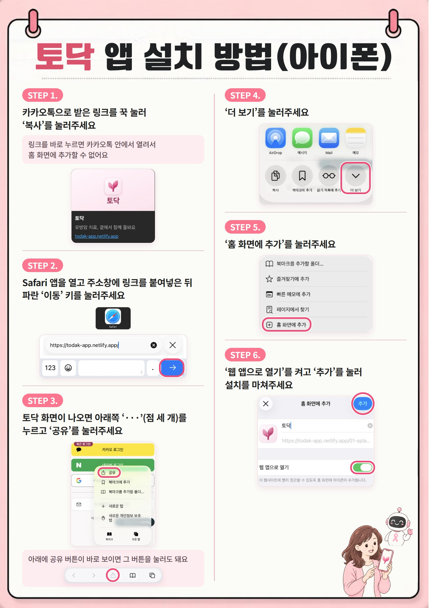

> [!참고]
> 아이폰 웹 앱은 새 판을 스스로 받아 오므로, 앱을 고치면 참여자가 따로 할 일 없이 바뀝니다. 알림은 홈 화면 아이콘으로 실행했을 때만 받을 수 있습니다(11장).

### 2.3 안드로이드

1. [설정] → [보안 및 개인정보 보호] → [보안 위험 자동 차단]을 끕니다. 켜져 있으면 설치가 아예 막힙니다.
2. 카카오톡으로 받은 토닥_Android.zip 파일을 누르고 [열기]를 누릅니다.
3. [압축 풀기]를 누릅니다.
4. 압축이 풀린 토닥_Android.apk를 누르고 [설치]를 누릅니다.
5. '권한 필요' 창이 나오면 [설정]을 누르고 [권한 허용]을 켭니다.
6. '앱을 설치하시겠습니까?' 창이 다시 나오면 [설치]를 누릅니다.
7. 경고 창이 나오면 [무시하고 설치]를 누릅니다.
8. 경고가 한 번 더 나오면 [무시하고 설치]를 눌러 설치를 마칩니다.
9. 설치가 끝나면 [보안 위험 자동 차단]을 다시 켭니다. 다시 켜도 토닥은 그대로 쓸 수 있습니다.

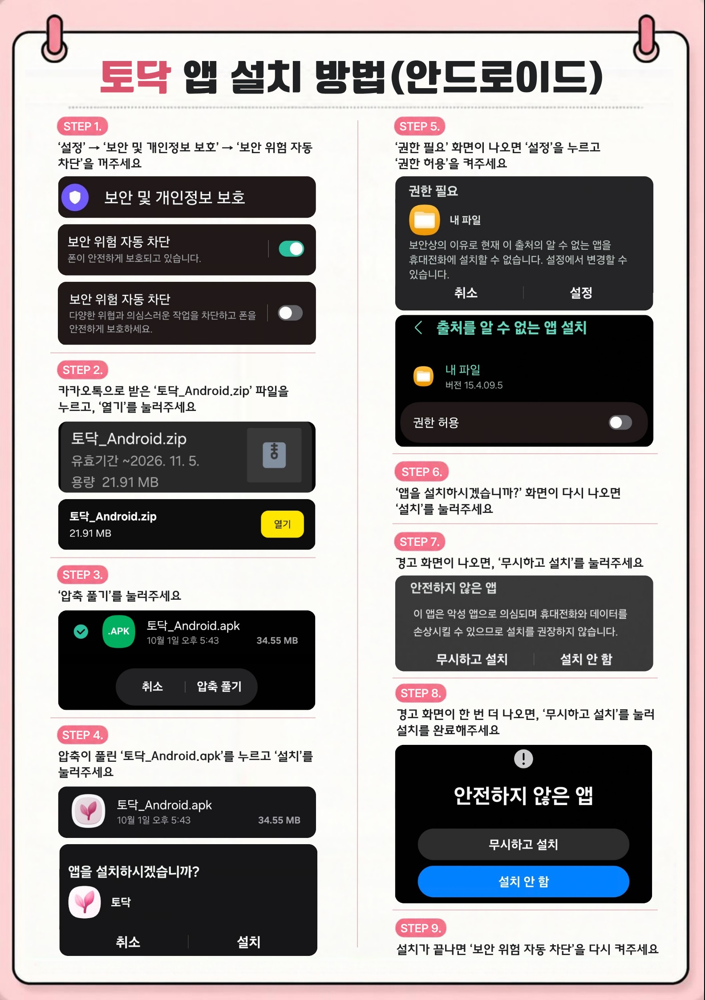

> [!주의]
> 안드로이드 앱은 화면 파일을 앱 안에 넣어 만든 것이라 스스로 바뀌지 않습니다. 앱을 고친 뒤에는 새 설치 파일을 다시 보내고, 참여자가 같은 방법으로 덮어 설치해야 합니다(13.5). 덮어 설치해도 기록은 서버에 있으므로 그대로 남습니다.

## 3. 가입과 처음 설정

처음 들어오면 아래 순서로 진행합니다. 중간에 앱을 닫아도 다음에 로그인하면 빠진 단계부터 다시 이어집니다.

1. 시작 화면에서 로그인
2. 약관 동의 (안드로이드는 이어서 휴대폰 권한 요청)
3. 환자 확인 서류 올리기
4. 기본 정보
5. 현재 받는 치료
6. 맞춤 설정
7. 토닥 사용법 5장 → 홈

### 3.1 로그인

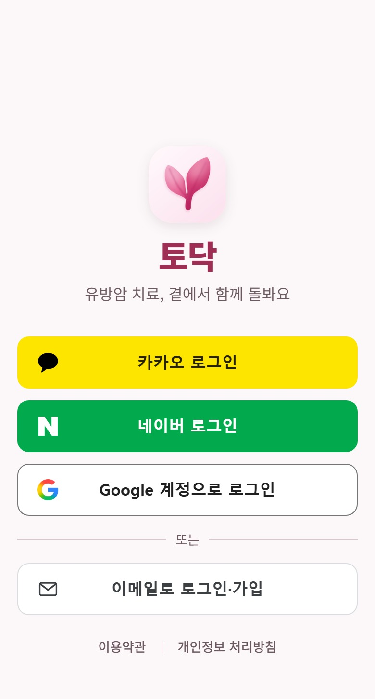

1. [카카오 로그인], [네이버 로그인], [Google 계정으로 로그인] 중 하나를 누릅니다. 따로 비밀번호를 만들지 않습니다.
2. 간편 로그인을 쓰지 않으면 [이메일로 로그인·가입]을 누릅니다. 처음이면 [처음이면 이메일로 가입하기]에서 이메일과 비밀번호(8자 이상)를 넣습니다.
3. 마지막으로 쓴 방법에는 '최근 로그인' 표시가 붙어, 다음에 어느 버튼으로 들어왔는지 헷갈리지 않습니다.

> [!참고]
> 이메일 비밀번호를 잊으면 로그인 화면의 [비밀번호 찾기]에서 재설정 메일을 받습니다. 메일 속 링크는 30분 동안 쓸 수 있습니다.

### 3.2 약관 동의

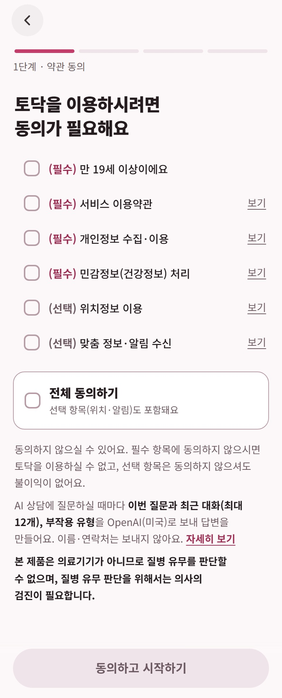

| 항목 | 구분 |
|---|:---:|
| 만 19세 이상이에요 | 필수 |
| 서비스 이용약관 | 필수 |
| 개인정보 수집·이용 | 필수 |
| 민감정보(건강정보) 처리 | 필수 |
| 위치정보 이용 | 선택 |
| 맞춤 정보·알림 수신 | 선택 |

1. 필수 네 가지에 모두 동의해야 [동의하고 시작하기]가 눌립니다. [전체 동의하기]는 선택 항목까지 켭니다.
2. 각 항목의 [보기]를 누르면 전문이 열립니다.
3. 안드로이드는 동의 직후 카메라·사진 권한을 묻고, 선택 항목을 켰다면 위치·알림 권한도 묻습니다. 거절해도 가입은 이어집니다.

> [!참고]
> 동의문 버전은 v6(시행일 2026-09-18)입니다. 동의 화면에는 AI 상담 때 이번 질문과 최근 대화(최대 12개), 부작용 유형을 OpenAI(미국)로 보내며 이름·연락처는 보내지 않는다는 안내가 함께 있습니다.

### 3.3 환자 확인 서류

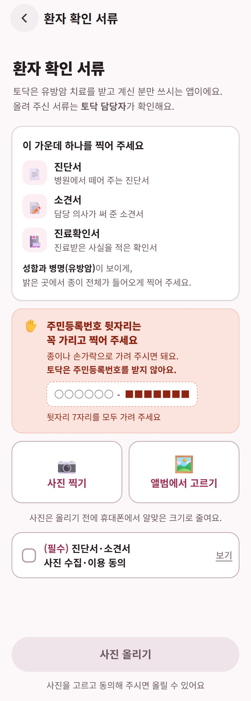

1. 진단서, 소견서, 진료확인서 중 한 장을 [사진 찍기] 또는 [앨범에서 고르기]로 올립니다. 성함과 병명(유방암)이 보여야 합니다.
2. 주민등록번호 뒷자리는 종이나 손가락으로 가리고 찍도록 안내합니다. 토닥은 주민등록번호를 받지 않습니다.
3. '진단서·소견서 사진 수집·이용 동의'(필수)에 동의하고 [사진 올리고 다음으로]를 누릅니다.

앱은 사진의 글자를 읽지 않습니다. 사진은 크기를 줄이고 촬영 정보(EXIF)를 지운 뒤 비공개 보관함에 올라가며, 연구팀이 직접 보고 승인합니다(13.1). 올리기에 실패하면 [가입 먼저 이어서 하기]로 넘어가고, 나중에 [내 정보] → [환자 확인 서류]에서 다시 올립니다.

### 3.4 기본 정보

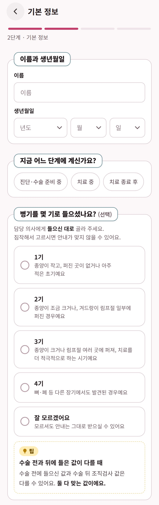 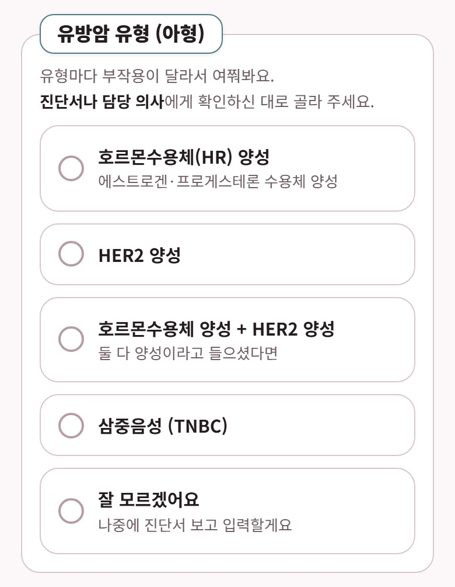 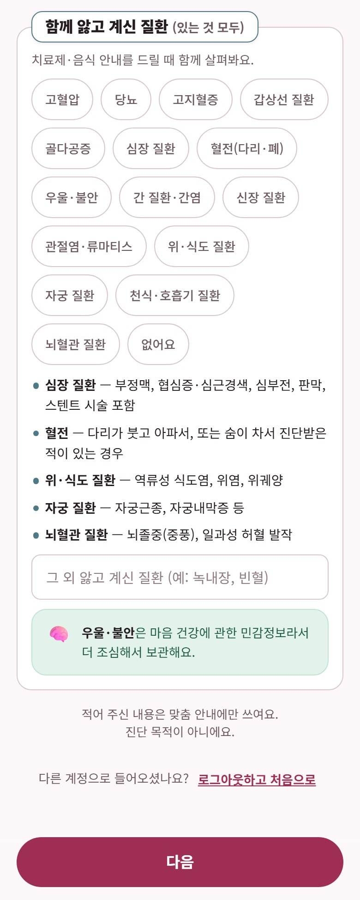

- 이름 — 연구팀이 서류 목록에서 보는 이름입니다. 간편 로그인 계정의 별명은 쓰지 않습니다.
- 생년월일 — 만 19세 미만이면 다음으로 넘어가지 않습니다.
- 지금 어느 단계에 계신가요 — 진단·수술 준비 중 / 치료 중 / 치료 종료 후 (필수)
- 병기 — 1기~4기 / 잘 모르겠어요 (선택)
- 유방암 유형 — 호르몬수용체 양성 / HER2 양성 / 둘 다 양성 / 삼중음성 / 잘 모르겠어요
- 함께 앓고 계신 질환 — 15개 중 여러 개, 또는 직접 입력

### 3.5 현재 받는 치료

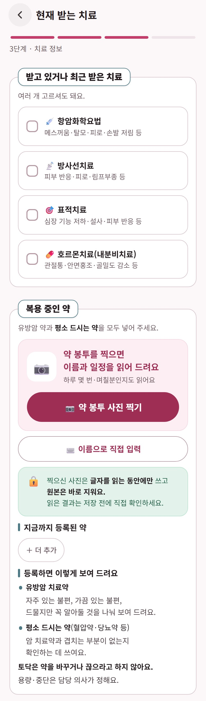 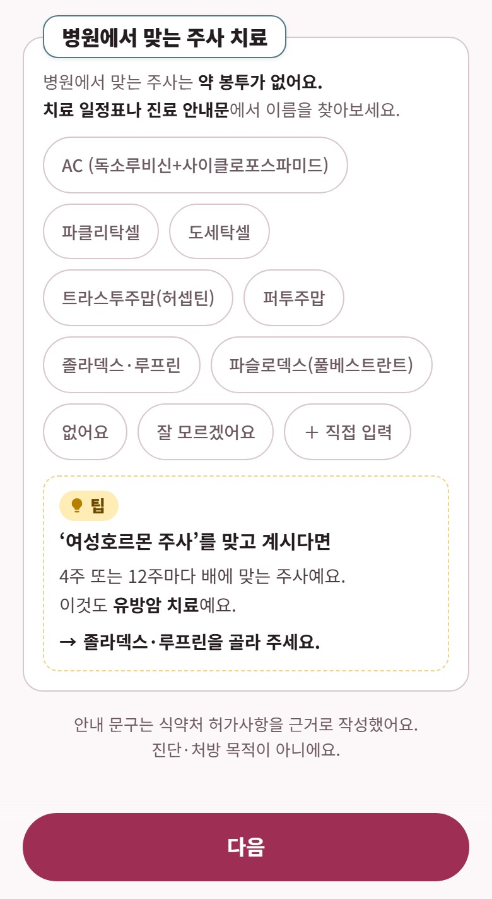

- 받고 있거나 최근 받은 치료 — 항암화학요법 / 방사선치료 / 표적치료 / 호르몬치료 (여러 개)
- 복용 중인 약 — 약 봉투 사진이나 이름으로 넣습니다. 나중에 넣어도 됩니다(6장).
- 병원에서 맞는 주사 치료 — AC, 파클리탁셀, 트라스투주맙(허셉틴), 졸라덱스·루프린 등에서 고릅니다.

여기서 고른 치료는 홈 '오늘의 한 가지'와 부작용 정보, AI 상담 답변에 쓰입니다. 고르지 않은 치료(예: 항암)를 전제로 한 안내는 띄우지 않습니다.

### 3.6 맞춤 설정과 사용법

1. 맞춤 설정에서 '지금 가장 걱정되거나 궁금한 부분'을 고릅니다(머리카락 빠짐, 손발 저림, 메스꺼움·구토 등 12개). 홈 '내가 신경 쓰는 부작용'에 나옵니다.
2. [완료하고 시작하기]를 누르면 토닥 사용법 5장이 나옵니다. [건너뛰기]로 넘길 수 있고, [내 정보] → [앱 사용법 다시 보기]에서 다시 봅니다.

> [!참고]
> 진료일과 알림은 가입 중에 받지 않습니다. 진료일은 홈의 진료 칸이나 [내 정보] → [치료 일정]에서 넣고(9.1), 아이폰 알림은 홈의 알림 띠나 [알림 설정]에서 켭니다(11장).

## 4. 홈 화면

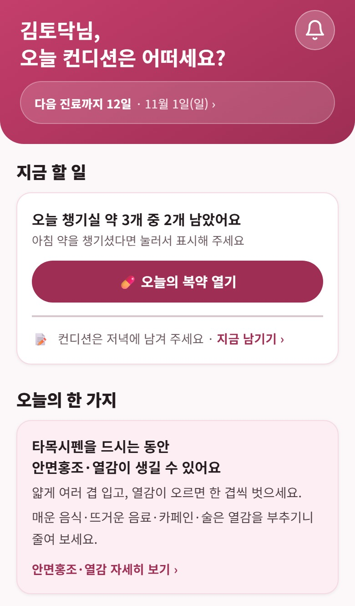 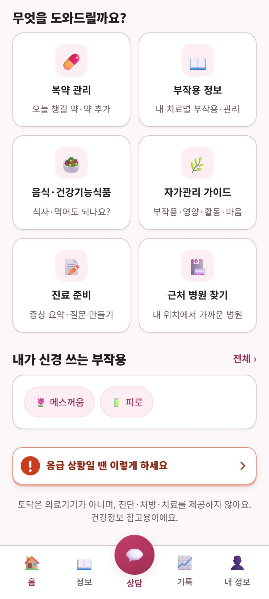

| 구역 | 내용 |
|---|---|
| 머리 칸 | 인사(오후 5시부터는 '오늘 하루도 고생하셨어요'), 다음 진료까지 남은 날, 오른쪽 위 알림 목록 |
| 지금 할 일 | 지금 해야 할 일 하나를 큰 버튼으로, 그 아래 오늘의 복약·컨디션 줄 |
| 오늘 뭐가 제일 힘드셨나요? | 누르면 먹기 편한 음식 화면으로 (속이 울렁거려요 / 입맛이 없어요 / 입안이 헐었어요) — 오후 5시부터, 또는 그날 컨디션을 남긴 뒤에 보입니다 |
| 오늘의 한 가지 | 오늘 남긴 증상 → 등록한 약 → 관심사 → 날마다 바뀌는 팁 순서로 골라 하나 |
| 무엇을 도와드릴까요? | 복약 관리 · 부작용 정보 · 음식·건강기능식품 · 자가관리 가이드 · 진료 준비 · 근처 병원 찾기 |
| 내가 신경 쓰는 부작용 | 맞춤 설정에서 고른 부작용 |
| 응급 상황일 땐 이렇게 하세요 | 응급 안내 화면(7.4) |

'지금 할 일'의 큰 버튼은 시각과 기록에 따라 바뀝니다.

| 상황 | 표시 |
|---|---|
| 약 먹을 시각(1시간 안) | 오늘 챙기실 약 N개 중 M개 남았어요 + [오늘의 복약 열기] |
| 저녁, 컨디션 기록 전 | 오늘 하루 어떠셨어요? + [오늘 컨디션 남기기] |
| 등록한 약이 없음 | 먹는 약을 등록하면 시간에 맞춰 알려 드려요 + [약 등록하기] |
| 할 일을 다 함 | 지금 챙길 것은 다 하셨어요 |

그 아래에는 조건이 맞을 때만 두 줄이 더 붙습니다. 약이 3일 안에 떨어지면 '약이 N일분 남았어요'(6.4), 진료 시각이 지난 날과 다음 날에는 '새로운 약을 처방받으셨나요?' + [약 추가하기] [받지 않았어요]입니다.

> [!참고]
> 안드로이드에서는 연구팀이 새 버전을 알리면 홈 맨 위에 '새 버전(vX)이 나왔어요.' 띠가 뜹니다(13.5). 홈을 불러오지 못하면 '…불러오지 못했어요' 띠와 [다시 열기]가 나오며, 이때도 남긴 기록과 등록한 약은 서버에 그대로 있습니다.

## 5. 컨디션 기록

아래쪽 [기록] 탭, 또는 저녁에 홈의 [오늘 컨디션 남기기]로 들어옵니다.

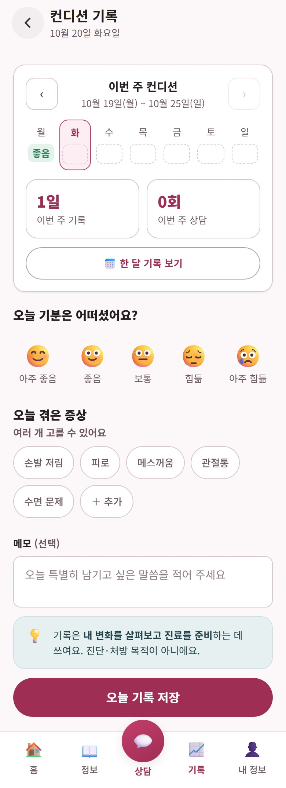

1. 오늘 기분을 다섯 단계(아주 좋음 / 좋음 / 보통 / 힘듦 / 아주 힘듦) 중에서 고릅니다. 기분은 꼭 골라야 저장됩니다.
2. 오늘 겪은 증상을 고릅니다. 기본 칩은 손발 저림, 피로, 메스꺼움, 관절통, 수면 문제이고 [＋ 추가]로 직접 넣을 수 있습니다.
3. 고른 증상마다 강도(없음 / 약함 / 보통 / 심함 / 매우 심함)를 고릅니다.
4. 메모(선택, 500자까지)를 쓰고 [오늘 기록 저장]을 누릅니다. 하루에 한 건으로 저장됩니다.

[한 달 기록 보기]를 누르면 달력으로 모아 봅니다. 날짜마다 기분이 색 점(좋음·보통·힘듦)으로 찍히고, 아래에 그달 자주 겪은 증상이 날수로 나옵니다.

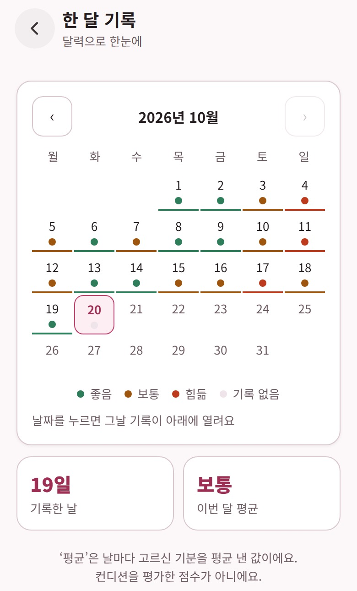 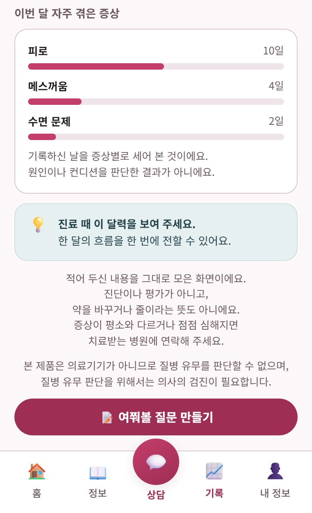

- 기록을 권하는 때 — 홈은 오후 5시부터, 알림은 매일 저녁(기본 20:00)과 매주 월요일 '마음 건강 체크'(기본 10:00).
- 기록이 다시 쓰이는 곳 — 한 달 기록, 진료 전 리포트(9.3), 홈 '오늘의 한 가지'.

## 6. 복약

### 6.1 약 등록

약은 세 가지 길로 넣습니다: 약 봉투 사진, 이름 직접 입력, 가입 중 '현재 받는 치료' 화면.

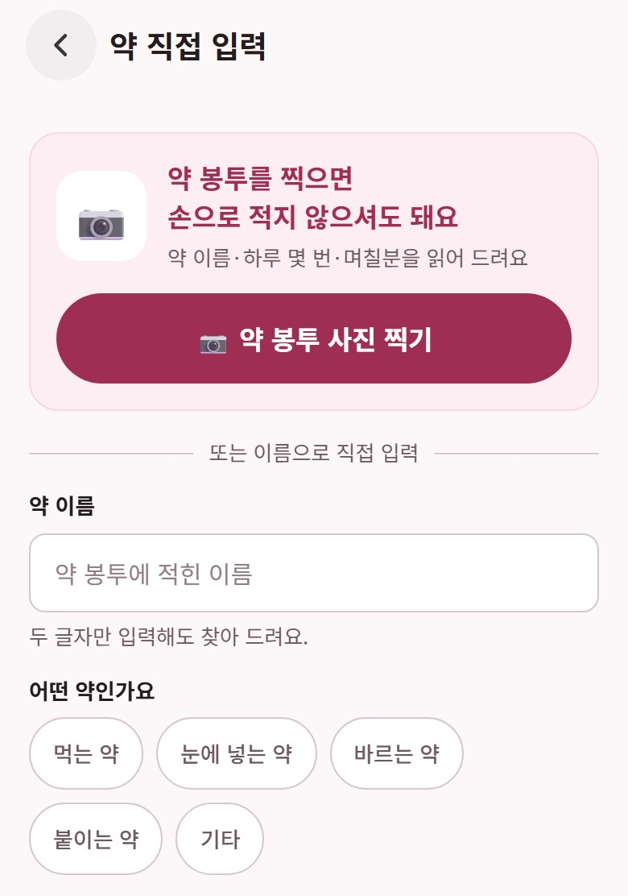 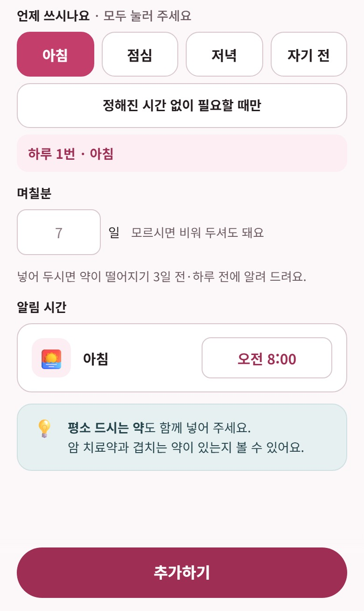

1. 약 이름을 두 글자 이상 넣으면 약 목록에서 찾아 줍니다.
2. 어떤 약인지(먹는 약 / 눈에 넣는 약 / 바르는 약 / 붙이는 약 / 기타)와 언제 쓰는지(아침 / 점심 / 저녁 / 자기 전, 또는 필요할 때만)를 고릅니다.
3. 며칠분인지 넣습니다. 넣어 두면 약이 떨어지기 전에 알려 줍니다(6.4).
4. 알림 시간을 확인하고 [추가하기]를 누릅니다. 기본 시각은 아침 8시, 점심 1시, 저녁 7시, 자기 전 10시입니다.

[약 봉투 사진 찍기]를 쓰면 사진에서 약 이름을 읽어 위 칸을 채워 줍니다.

| 항목 | 안드로이드 | 아이폰 |
|---|---|---|
| 글자 읽기 | 휴대폰 안에서 (ML Kit, 한국어) | 브라우저 안에서 (Tesseract) — 처음 한 번은 준비에 1분쯤 걸립니다 |
| 사진 | 읽은 즉시 지웁니다. 서버로 보내지 않습니다 | 같음 |
| 결과 | 읽은 글자를 약 목록과 맞춰, 한 종이면 직접 입력 화면이 채워진 채로, 여러 종이면 '사진에서 찾은 약' 확인 화면으로 넘어갑니다. 주사약으로 보이는 약은 자동으로 빼 둡니다 | 같음 |

> [!참고]
> 같은 이름의 약을 다시 넣으면 '이미 등록된 약이에요' 창이 뜹니다. [새로 받아 왔어요]를 누르면 며칠분을 오늘부터 다시 셉니다. 같은 약을 두 번 넣지 않도록 참여자에게 안내합니다.

### 6.2 오늘의 복약

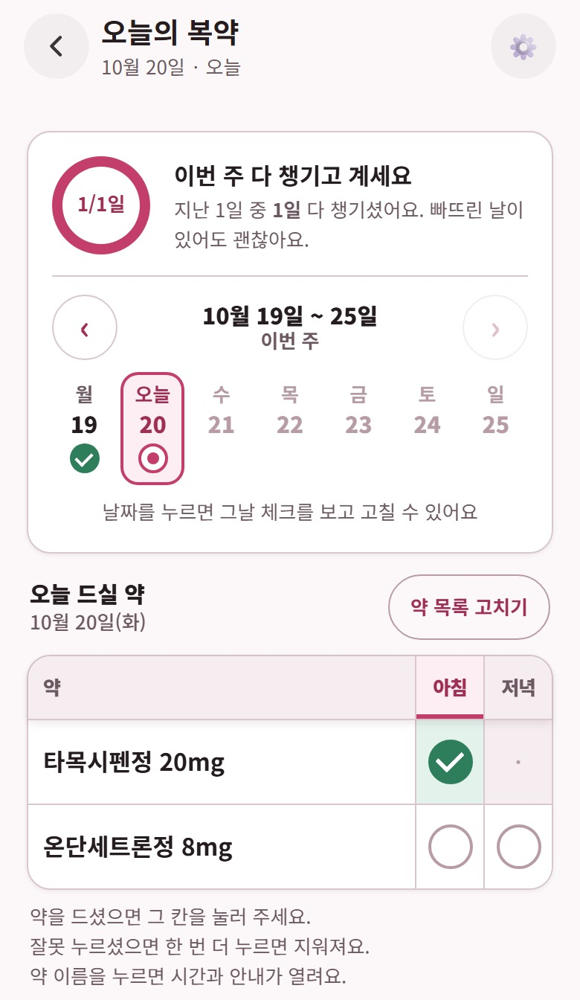 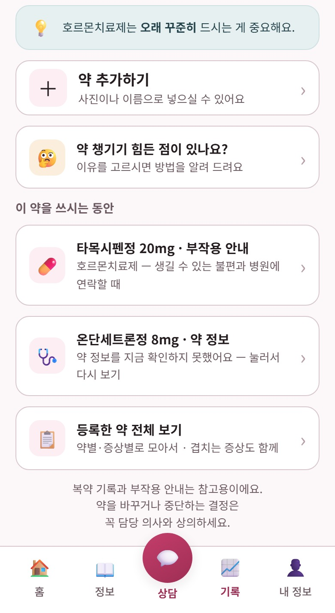

1. '오늘 드실 약' 표에서 약을 드신 칸을 누르면 ✓가 찍히고, 다시 누르면 지워집니다.
2. 위쪽 주간 줄에서 날짜를 누르면 지난 날의 체크도 보고 고칠 수 있습니다. [‹]로 처음 약을 넣은 주까지 돌아갑니다.
3. 어제 빈 칸이 있으면 '어제 빈 칸이 N개 있어요' 띠와 [어제 기록 열기]가 뜹니다.
4. 아래 '이 약을 쓰시는 동안'에서 약별 부작용 안내와 약 정보(식약처 허가정보)를 봅니다.

> [!참고]
> 지난 날의 체크를 나중에 고치면 서버 복약 기록(med_logs)에 고친 날이 함께 남습니다(late·updated_at). 복약 순응도를 집계할 때 그날 바로 체크한 것과 나중에 채운 것을 나눠 볼 수 있습니다.

### 6.3 복약 설정

[내 정보] → [복약 설정], 또는 오늘의 복약 화면의 [약 목록 고치기]로 들어옵니다.

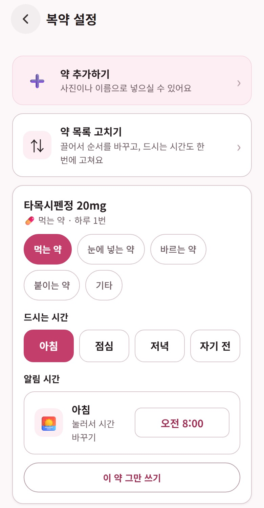 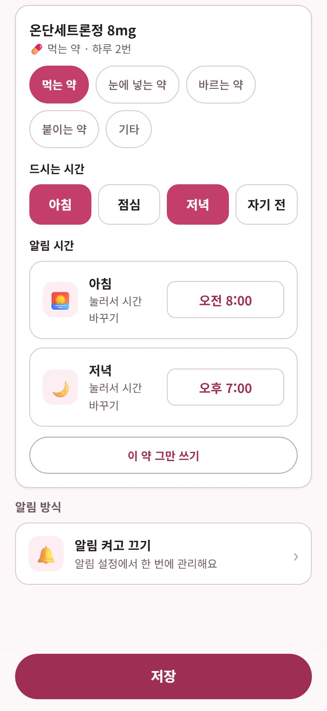

- 약마다 드시는 시간과 알림 시간을 바꿉니다. 바꾼 내용은 오늘부터 적용되고, 지난 날의 기록은 그날 시간 그대로 남습니다.
- [약 목록 고치기]에서는 약 왼쪽 손잡이를 잡고 끌어 순서를 바꿉니다.
- 더 이상 쓰지 않는 약은 [이 약 그만 쓰기]를 누릅니다. 목록에서 빠지고 알림도 멈춥니다.

> [!주의]
> 며칠분이 다 지나도 복약 알림은 끊기지 않습니다. 약을 끊은 참여자가 '알림이 계속 온다'고 하면 [이 약 그만 쓰기]를 누르도록 안내합니다.

### 6.4 약 떨어짐 안내와 진료 뒤 확인

며칠분과 시작일을 아는 약은 떨어지기 3일 전과 하루 전 오전 9시에 알림을 보냅니다. 잠금 화면에 보이는 알림에는 약 이름을 넣지 않고('등록하신 약이 3일분 남았어요'), 홈의 '지금 할 일' 줄에만 약 이름을 씁니다. 다음 진료와 날짜를 맞춰 '이번 진료 때 처방을 받아 오세요' 또는 '병원에 미리 연락해 보세요'로 문구가 바뀝니다.

진료 시각이 지나면 그날과 다음 날 홈에 '새로운 약을 처방받으셨나요?'가 뜹니다. [약 추가하기]를 누르거나 [받지 않았어요]를 누르면 사라집니다.

### 6.5 약 챙기기 힘든 점

오늘의 복약 화면의 [약 챙기기 힘든 점이 있나요?]에서 이유(관절이 아파서, 깜빡 잊어서, 약 먹는 게 지쳐서 등)를 고르면 그에 맞는 안내가 열립니다. 고른 내용은 서버로 보내지 않습니다. 깜빡 거른 약은 '다음에 두 번 드시지 마세요'로 안내합니다.

## 7. AI 상담

### 7.1 쓰는 법

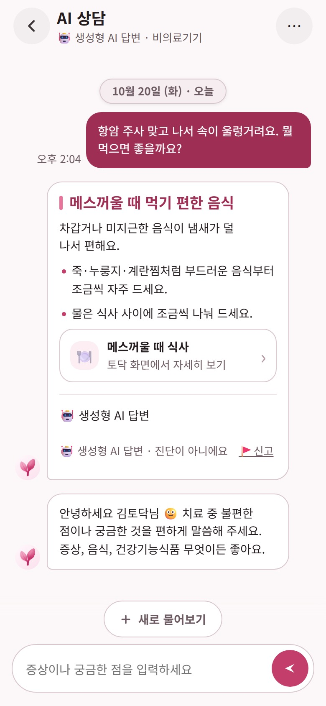

1. 가운데 [상담] 버튼을 누르고 증상이나 궁금한 점을 적어 보냅니다(한 번에 500자까지). 아래쪽 추천 칩을 눌러도 됩니다.
2. 답은 주제별 칸으로 나뉘고, 관련된 토닥 화면 카드([토닥 화면에서 자세히 보기])가 붙습니다. 토닥 자료에 없는 내용이면 '토닥 자료에 없는 일반 정보예요. 담당 의사에게 확인해 주세요'가 붙습니다.
3. [새로 물어보기]를 누르면 지금까지의 이야기를 접고 새로 시작합니다. 지난 대화는 오른쪽 위 [⋯] → '대화 기록'에 남습니다.
4. 모든 답 아래에 '생성형 AI 답변 · 진단이 아니에요'와 [신고]가 있습니다. 신고 사유(정보가 틀린 것 같아요, 위험해 보여요 등)는 서버에 모입니다.

### 7.2 답하는 범위

- 부작용, 음식·건강기능식품, 치료 중 생활에 답합니다.
- 진단·처방·응급 판정을 하지 않고, 병기·생존율 같은 예후 수치에 답하지 않습니다.
- 약을 바꾸거나 끊으라는 말을 하지 않습니다.
- 사례비·설문 일정처럼 연구 운영에 관한 질문에는 답을 짐작하지 않고, 가입 때 받은 안내문을 보도록 고정 문구로 답합니다.

AI에 보내는 것은 이번 질문, 최근 대화 12개, 앱 안 자료 일부, 본인의 치료 단계·치료 종류·등록한 약 이름입니다. 이름과 연락처는 보내지 않습니다.

### 7.3 하루 사용 한도

한 사람당 24시간에 60번까지 물을 수 있습니다. 넘으면 '오늘은 질문을 많이 해 주셨어요. 내일 다시 물어봐 주세요.'가 나옵니다. 비용 관리는 13.6을 봅니다.

### 7.4 위험 신호 안내

질문에 위험 신호가 보이면 답 앞에 경고 문구와 전화 버튼이 붙습니다. 앱과 서버가 같은 기준으로 판정합니다.

| 단계 | 화면에 붙는 것 |
|---|---|
| 응급 (예: 숨이 차거나 의식이 흐려짐) | '119에 바로 연락하세요' + [119 연결·위험신호 보기] |
| 오늘 연락 (예: 항암 중 38도 이상 열) | '치료받는 병원으로 최대한 빠르게 연락해야 해요' + [병원 연락처·위험신호 보기] |
| 마음 위기 | 자살예방 상담전화 109, 정신건강 위기상담 1577-0199 안내 + [마음 상담 전화 연결] |

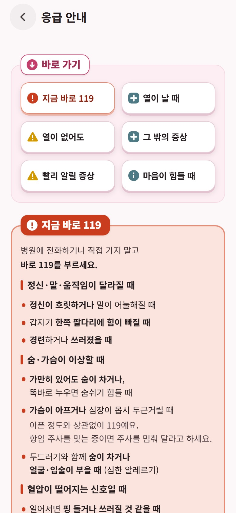

홈의 '응급 상황일 땐 이렇게 하세요'도 같은 응급 안내 화면을 엽니다. 지금 바로 119, 병원에 바로 연락할 증상, 빨리 알릴 증상, 마음이 힘들 때로 나뉩니다.

> [!주의]
> 위험 신호 안내는 참여자가 문장으로 적은 내용을 보고 거는 보조 장치입니다. 적지 않은 증상은 잡지 못하므로, 응급 대응은 문서 앞쪽 '주의'대로 안내합니다.

## 8. 부작용·음식 정보

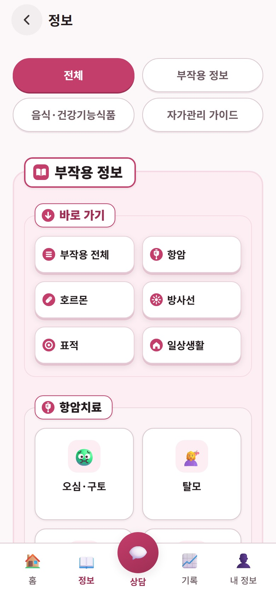

아래쪽 [정보] 탭은 위쪽 네 칸(전체 / 부작용 정보 / 음식·건강기능식품 / 자가관리 가이드)으로 나뉩니다.

| 화면 | 내용 |
|---|---|
| 부작용 정보 | 치료(항암·호르몬·방사선·표적)별 부작용. 상세 화면은 '이게 왜 생겨요? → 이렇게 관리해요 → 음식 → 이럴 땐 병원에(지금 바로 119 / 그날 안에 연락 / 다음 진료 때)' 순서 |
| 음식·건강기능식품 | 약과 함께 조심할 음식, 증상별 식사(메스꺼울 때, 입맛 없을 때 등), 건강기능식품·한약 |
| 이거 먹어도 되나요? | 음식·건강기능식품 이름으로 찾기. 목록에 없으면 AI 상담으로 일반 정보를 찾습니다(상담과 같은 하루 한도) |
| 자가관리 가이드 | 부작용별 관리, 영양, 활동, 마음 |
| 내 약과 부작용 | 등록한 약 기준 부작용·주의사항 (식약처 허가정보) |

자료 출처는 [내 정보] → [이 앱이 쓰는 자료]에 모여 있습니다(국제 자료, 국내 학회 지침, 정부·공공기관 자료, 학술 문헌).

## 9. 진료 준비

### 9.1 치료 일정

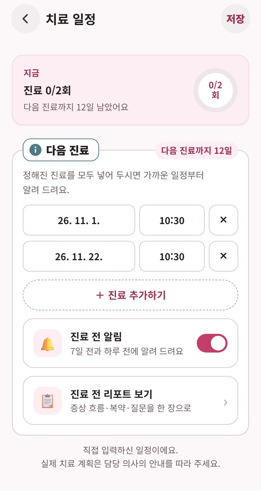

1. 홈의 진료 칸이나 [내 정보] → [치료 일정]에서 [＋ 진료 추가하기]로 날짜와 시간을 넣고 [저장]을 누릅니다. 여러 번 넣을 수 있습니다.
2. '진료 전 알림'을 켜 두면 진료 7일 전과 하루 전 오전 9시에 알려 줍니다.

### 9.2 여쭤볼 질문 만들기

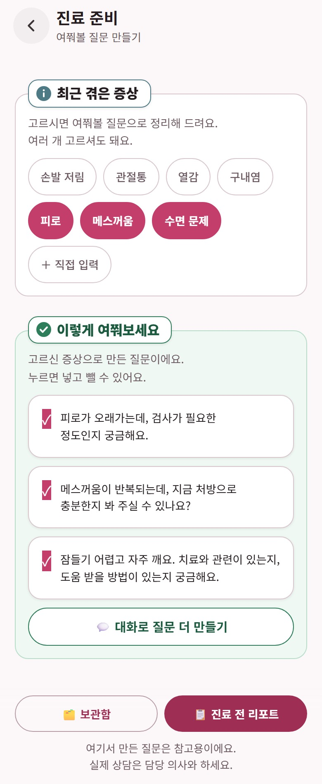

1. 홈의 [진료 준비]에서 최근 겪은 증상을 고르면 '이렇게 여쭤보세요' 질문 카드가 만들어집니다.
2. 카드를 눌러 넣고 뺍니다. [대화로 질문 더 만들기]는 AI 상담으로 이어집니다.
3. 만든 질문은 [보관함]에 모입니다.

> [!주의]
> 여쭤볼 질문과 보관함은 그 휴대폰에만 저장됩니다. 로그아웃하거나 휴대폰을 바꾸면 사라지고, 연구팀이 서버에서 볼 수도 없습니다.

### 9.3 진료 전 리포트

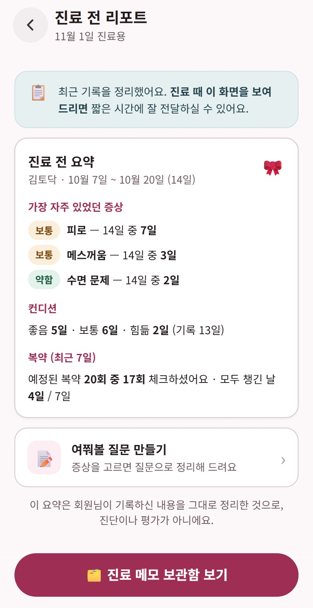

최근 14일 기록을 한 화면에 모읍니다: 가장 자주 있었던 증상(14일 중 며칠, 세기), 컨디션(좋음·보통·힘듦 날수), 최근 7일 복약, 여쭤볼 질문. 진료실에서 이 화면을 의사에게 보여 주는 방식이며, 따로 보내거나 인쇄하는 기능은 없습니다.

## 10. 병원 찾기

홈의 [근처 병원 찾기]로 들어옵니다.

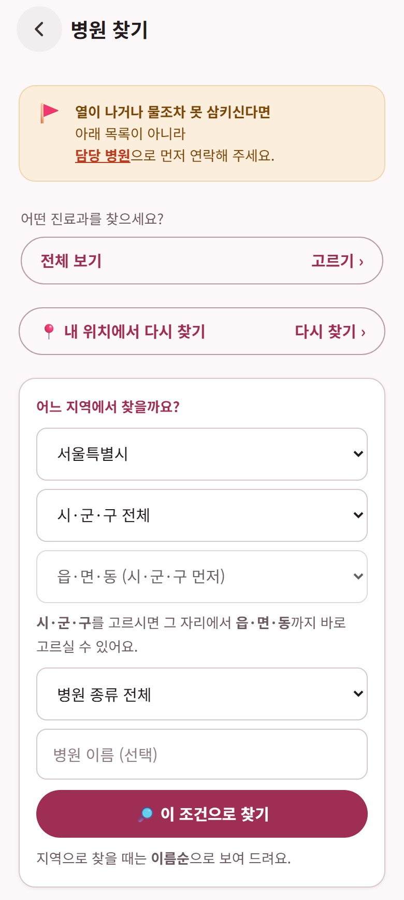 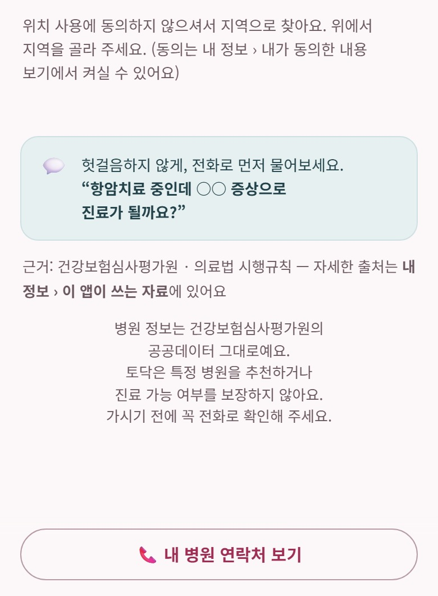

1. 진료과(전체 또는 내과·이비인후과 등 13개)를 고릅니다.
2. 위치 사용에 동의했으면 내 위치에서 가까운 순으로, 아니면 시·도 → 시·군·구 → 읍·면·동을 골라 찾습니다.
3. 병원 카드에서 [전화], [길찾기], [주소복사]를 씁니다.

- 맨 위에는 열이 나거나 물조차 못 삼키면 이 목록이 아니라 담당 병원에 먼저 연락하라는 안내가 있습니다. [내 병원 연락처 보기]에는 참여자가 넣어 둔 담당 병원의 외래·응급실 번호가 있습니다.
- 병원 자료는 건강보험심사평가원 공공데이터입니다. 서버에는 지역 이름만 보내고, 위치 좌표는 휴대폰 안에서 거리 계산에만 씁니다(지도를 그릴 때만 그 순간의 위치가 카카오맵으로 갑니다). 좌표는 어디에도 저장하지 않습니다.

## 11. 알림

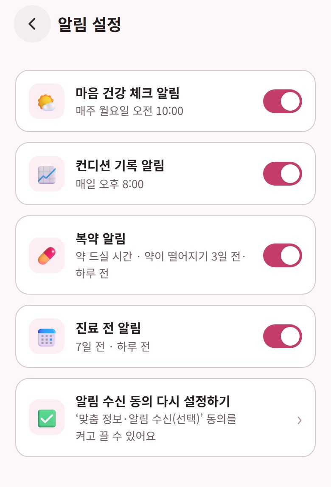

| 알림 | 시각 | 끄고 켜는 곳 |
|---|---|---|
| 복약 — '아침 약 드실 시간이에요' | 약별 알림 시간 | 복약 알림 |
| 약이 곧 떨어져요 | 떨어지기 3일 전·하루 전 09:00 | 복약 알림 |
| 컨디션 기록 — '오늘 하루 어떠셨어요?' | 매일, 기본 20:00 | 컨디션 기록 알림 |
| 마음 건강 체크 | 매주 월요일, 기본 10:00 | 마음 건강 체크 알림 |
| 진료가 다가와요 | 진료 7일 전·하루 전 09:00 | 진료 전 알림 |

| 항목 | 안드로이드 | 아이폰 |
|---|---|---|
| 방식 | 휴대폰 안에서 예약하는 알림 | 서버가 보내는 웹 푸시 |
| 켜는 조건 | 휴대폰 알림 권한 허용 | 홈 화면 아이콘으로 실행 + [알림 켜기] 허용 |
| 시각 | 정해진 시각 (복약은 '정확한 알람'). 인터넷이 끊겨도 이미 걸린 예약은 울림 | 정해진 시각부터 최대 5분 늦을 수 있음 |

- 약관 동의에서 '맞춤 정보·알림 수신'을 끈 참여자에게는 어떤 알림도 가지 않습니다. 알림 설정 화면의 [알림 수신 동의 다시 설정하기]에서 켭니다.
- 잠금 화면에 보이는 알림에는 약 이름 같은 건강정보를 넣지 않습니다.
- 안드로이드에서 복약 알림이 늦게 오면 알림 설정 화면이 '알람 및 리마인더' 켜기와 '앱 절전 관리 → 제한 없음'을 안내합니다.

## 12. 내 정보

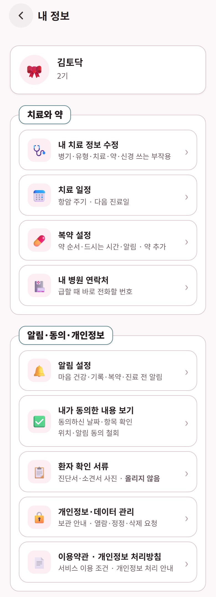 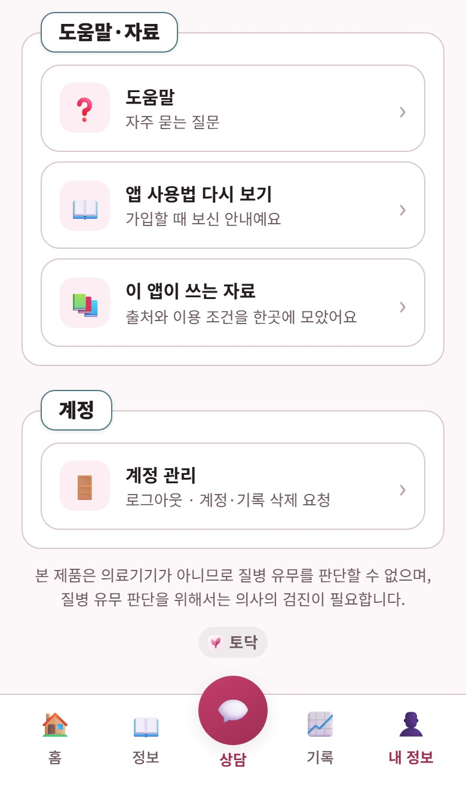

| 메뉴 | 하는 일 |
|---|---|
| 내 치료 정보 수정 · 치료 일정 · 복약 설정 · 내 병원 연락처 | 가입 때 넣은 정보와 진료일·약·담당 병원 번호를 고칩니다 |
| 알림 설정 | 알림 종류별로 켜고 끕니다 (11장) |
| 내가 동의한 내용 보기 | 동의한 때와 버전, 변경 이력. 선택 항목(위치·알림)은 여기서 바로 켜고 끕니다 |
| 환자 확인 서류 | 상태 표시: 올리지 않음 / 확인 중 / 확인 완료 / 다시 올려 주세요 |
| 개인정보·데이터 관리 | 보관 기간 안내, 보기·고치기·지우기 요청 |
| 이용약관 · 개인정보 처리방침 | 전문 |
| 도움말 · 앱 사용법 다시 보기 · 이 앱이 쓰는 자료 | 자주 묻는 질문 12개(검색 가능), 사용법 5장, 출처 |
| 계정 관리 | 로그인한 방법 확인, 로그아웃, 계정·기록 삭제 요청 |

- 앱 버전은 화면 맨 아래에 '토닥 v0.9.4'로 표시됩니다. 문의가 오면 이 버전을 먼저 확인합니다.
- 앱 안에서 계정을 바로 지우거나 기록을 내려받는 기능은 없습니다. 필수 동의 철회, 열람·정정·삭제 요청은 모두 개인정보 보호책임자 이메일(jamesyoun@dju.kr)로 받고, 계정·기록 삭제는 요청일부터 10일 안에 처리합니다.
- 로그아웃하면 그 휴대폰에 남은 토닥 자료(여쭤볼 질문 등)와 알림 예약이 지워집니다. 서버의 기록은 남습니다.

## 13. 연구팀 운영

### 13.1 환자 확인 서류 승인

1. 수파베이스 대시보드 → Table Editor에서 schema를 staff로 바꾸고 '환자확인서류_목록'을 엽니다. 이름(기본 정보에서 적은 이름, 아직 안 적었으면 '(이름 입력 전)'), 이메일, 올린 시각, 상태가 보입니다.
2. 서류 사진은 Storage의 verify-docs 보관함에서 봅니다. 폴더 이름은 계정 id입니다.
3. 승인·반려는 public.patient_verifications 표의 status를 approved 또는 rejected로 바꿉니다. note 칸에 적은 말은 참여자 화면에 '토닥 담당자: …'로 그대로 보입니다.

### 13.2 서버에 쌓이는 자료

| 표 | 담는 것 |
|---|---|
| profiles | 이름·생년월일·치료 단계·유형·동반 질환·걱정·진료 일정·담당 병원·알림 설정 |
| checkins | 컨디션 기록 (하루 1건) |
| medications · med_logs | 등록한 약과 일정 · 복약 체크 (나중에 고친 표시 포함) |
| chat_messages | AI 상담 대화 — 연구용 사용기록이 아니라 참여자 계정 자료입니다 |
| app_events | 사용기록 (앱 열기, 상담 질문, 컨디션 저장, 복약 체크, 정보 열람, 병원 찾기 등 이름만) |
| consent_records | 동의 기록 — 추가만 되고 고치거나 지울 수 없습니다 |
| answer_reports | AI 답변 신고 |
| patient_verifications | 환자 확인 서류 상태 |

> [!참고]
> 사용기록(app_events)은 현재 버전 동의가 확인된 참여자만 남습니다. chat_call은 비용 한도를 세는 값이므로 연구 집계에서는 빼고 chat_question을 씁니다.

### 13.3 휴대폰에만 남는 것

여쭤볼 질문과 보관함, 사진으로 읽고 아직 등록하지 않은 약, '받지 않았어요' 표시, 마지막 로그인 방법은 휴대폰에만 남고 서버로 가지 않습니다. 위치 좌표는 휴대폰에도 서버에도 저장하지 않습니다.

### 13.4 백업

무료 요금제라 수파베이스가 자동으로 백업하지 않습니다. 7_DB_수파베이스/DB백업하기.bat을 두 번 누르면 같은 폴더의 '백업'에 날짜가 붙은 zip이 생깁니다. 주 1회 실행하고, 백업 파일은 노트북 밖(USB 등)에도 두는 것을 권합니다. 서류 사진까지 받으려면 --photos 옵션으로 실행합니다.

### 13.5 새 버전 내보내기

| 대상 | 방법 |
|---|---|
| 아이폰 | 넷리파이에 새 판을 올리면 참여자가 앱을 열 때 저절로 바뀝니다 |
| 안드로이드 | 새 토닥_Android.zip을 카카오톡으로 보내고 2.3과 같은 방법으로 덮어 설치하게 합니다 |

새 파일을 보낼 때 아래 SQL을 수파베이스 SQL Editor에서 실행하면, 안드로이드 홈에 '새 버전(v0.9.5)이 나왔어요. 새 버전은 토닥 담당자가 전해 드려요.' 띠가 뜹니다. 숫자는 새 버전 번호로 바꿉니다.

`update public.app_config set value = '{"latest":"0.9.5","note":"","url":""}' where key='version';`

### 13.6 AI 상담 비용

질문 하나에 OpenAI를 한 번 부르고, 한 번에 약 0.003달러가 듭니다. 한 사람이 24시간에 60번까지 물을 수 있습니다. 선불 잔액이 떨어지면 모든 참여자의 상담이 '지금은 답변을 드릴 수 없어요'로 멈추므로, OpenAI 대시보드의 잔액을 가끔 확인합니다. 참여자별 사용량은 app_events의 chat_call 수로 셉니다(OpenAI 대시보드에는 참여자 구분이 없습니다).

### 13.7 동의문을 바꿀 때

동의문 문구를 바꾸고 버전을 올리면, 모든 참여자가 다음에 앱을 열 때 약관 동의 화면에서 다시 동의해야 합니다. 이전 동의 기록은 consent_records에 그대로 남습니다.

## 14. 문제 해결

| 증상 또는 화면 문구 | 확인할 것 |
|---|---|
| 아이폰에서 '홈 화면에 추가'가 없다 | 카카오톡 안에서 링크를 연 것. 링크를 복사해 Safari에서 엽니다 |
| 안드로이드 설치가 막힌다 | [보안 위험 자동 차단]이 켜져 있음. 끄고 설치한 뒤 다시 켭니다 |
| 카카오톡 파일이 열리지 않는다 | 유효기간(약 2주) 지남. 파일을 다시 보냅니다 |
| 이메일 또는 비밀번호가 맞지 않아요. | 가입 전이면 [처음이면 이메일로 가입하기], 비밀번호를 잊었으면 [비밀번호 찾기] |
| 이 이메일로 이미 가입된 계정이 있어요. 이메일 로그인으로 들어와 주세요 | 같은 이메일로 이메일 가입을 먼저 했음. [이메일로 로그인·가입]으로 들어옵니다 |
| 링크 유효시간이 지났어요. / 로그인을 마치지 못했어요. | 로그인 버튼을 다시 누릅니다 |
| 인터넷 연결을 확인해 주세요. / 연결이 원활하지 않아요. | 와이파이·데이터를 확인하고 잠시 뒤 다시 엽니다. 기록은 서버에 그대로 있습니다 |
| 약 이름을 찾지 못했어요. / 사진을 읽지 못했어요. | 글자가 잘 보이게 다시 찍거나 [직접 입력]. 아이폰은 첫 사진 인식에 1분쯤 걸립니다 |
| 아이폰에서 알림이 오지 않는다 | 홈 화면 아이콘으로 실행했는지, [알림 켜기]를 허용했는지, 동의 화면의 알림 수신을 켰는지 |
| 안드로이드에서 알림이 오지 않거나 늦다 | 휴대폰 알림 권한, '알람 및 리마인더', 앱 절전 '제한 없음' (알림 설정 화면 안내) |
| 약을 끊었는데 복약 알림이 계속 온다 | [복약 설정] → [이 약 그만 쓰기] |
| 오늘은 질문을 많이 해 주셨어요. | 24시간 60번 한도. 다음 날 다시 묻습니다 |
| 지금은 답변을 드릴 수 없어요. | 서버나 OpenAI 쪽 문제. 연구팀이 OpenAI 잔액과 수파베이스 상태를 확인합니다 |
| 진료 질문 보관함이 비었다 | 로그아웃했거나 휴대폰을 바꿈. 질문은 휴대폰에만 저장됩니다 |
| 환자 확인 서류가 '다시 올려 주세요' | 연구팀이 반려함. 남긴 말을 보고 [내 정보] → [환자 확인 서류]에서 다시 올립니다 |
| 안드로이드 홈에 '새 버전이 나왔어요' 띠 | 연구팀이 보낸 새 설치 파일로 덮어 설치합니다 |
